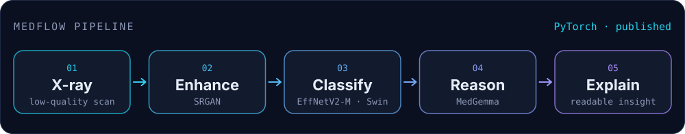
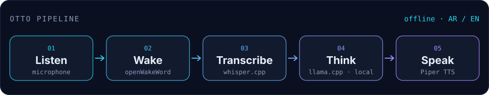

  

  <a href="https://www.linkedin.com/in/amr-ebrahim-el-sayed">LinkedIn</a>
  &nbsp;·&nbsp;
  <a href="mailto:amr433606@gmail.com">Email</a>
  &nbsp;·&nbsp;
  <a href="https://ieeexplore.ieee.org/document/11417605/">IEEE paper</a>
  &nbsp;·&nbsp;
  Alexandria, Egypt

 

I build AI systems end to end — from messy input data to a model that runs inside a working pipeline.
The problems I like most sit between research and product: taking something that works in a notebook and turning it into a tool people can actually use.

- **Medical imaging research** — co-authored a peer-reviewed paper (JAC-ECC 2025, IEEE Xplore) on how super-resolution changes the diagnostic accuracy of chest X-ray models.
- **LLMs that run locally** — built Otto, a voice assistant that listens, thinks and answers in Arabic and English, fully offline.
- **Automation & data** — build no-code AI workflows with Make and n8n, plus SQL, dashboards and exploratory data analysis.
- **Hardware** — build with Raspberry Pi 5 and Arduino, and teach AI and robotics to learners at every level.

B.Sc. Computer Science & Engineering · Egypt-Japan University of Science and Technology (E-JUST), 2021–2026 · Arabic (native) · English (fluent)

 

## Featured work

### MedFlow — from a blurry X-ray to an explained diagnosis

Low-quality scans hide diagnostic detail, and raw model scores are hard for clinicians to interpret.
MedFlow is a modular pipeline that first restores the image, then detects pneumonia, then uses a medical vision-language model to explain the result in plain language.

| Stage | Metric | Result |
| :-- | :-- | :-- |
| Super-resolution (SRGAN) | PSNR / SSIM | **49.37 dB** / **0.996** |
| Pneumonia detection | Accuracy / F1 | **93.11%** / **0.9374** |
| Effect of super-resolution (paper) | AUC | up to **+19%** |

**My part:** built the AI research pipeline — the super-resolution and classification models (CNN, EfficientNetV2-M, Swin Transformer) and their benchmarks — and integrated Google's MedGemma for clinical reasoning. Co-authored the resulting paper.

`Python` `PyTorch` `SRGAN` `EfficientNetV2-M` `Swin Transformer` `MedGemma`

[Paper on IEEE Xplore](https://ieeexplore.ieee.org/document/11417605/) &nbsp;·&nbsp; [Team repository](https://github.com/Assem-ElQersh/MedFlow-V2)

 

### Otto — an offline voice assistant that speaks Arabic and English

Most voice assistants send your voice to the cloud. Otto runs the whole loop on your own Windows PC: say *"Hey Otto"*, ask in Arabic or English, and it answers out loud — with no cloud requests and no telemetry.

**How it works:** wake-word detection (openWakeWord) → speech-to-text (whisper.cpp) → a local LLM served by llama.cpp → neural text-to-speech (Piper, with English and Arabic voices).

**My part:** designed and built the full pipeline.

`Python` `openWakeWord` `whisper.cpp` `llama.cpp` `Piper TTS` `Local LLMs`

[Repository](https://github.com/Amr-Ebrahim/Otto-Assistant)

 

## Toolkit

<table>
  <tr>
    <td width="170"><b>AI &amp; deep learning</b></td>
    <td>
      
      
      <img src="https://img.shields.io/badge/scikit--learn-121A2E?style=for-the-badge&logo=data%3Aimage%2Fsvg%2Bxml%3Bbase64%2CPHN2ZyB4bWxucz0iaHR0cDovL3d3dy53My5vcmcvMjAwMC9zdmciIHZpZXdCb3g9IjAgMCAyNCAyNCIgZmlsbD0iI0Y3OTMxRSIgY29sb3I9IiNGNzkzMUUiPjxwYXRoIGQ9Ik0xNS42MDEgNS41M2MtMS45MS4wMzUtMy45ODEuOTEtNS42MyAyLjU2LTIuOTMgMi45My0yLjA4MyA4LjUzLTEuMDg4IDkuNTI1LjgwNS44MDQgNi41OTUgMS44NDMgOS41MjYtMS4wODhhOS43NCA5Ljc0IDAgMCAwIC41ODQtLjY0M2MuMDQzLS4yOTIuMjA1LS42Ni40ODktMS4xMDZhMS44NDggMS44NDggMCAwIDEtLjUzNy4xNzZjLS4xNDQuMjY1LS4zNy41NS0uNjc2Ljg1NS0uMzU0LjMzNS0uNjA3LjU1NC0uNzYuNjU2YS43OTUuNzk1IDAgMCAxLS40MzcuMTUyYy0uMzUgMC0uNTE0LS4zMDgtLjQ5NC0uOTI0LS4yMi4zMTYtLjQyNS41NDktLjYxMi43YS45MTQuOTE0IDAgMCAxLS41NzguMjI0Yy0uMTk0IDAtLjM2LS4wOS0uNDk2LS4yNzNhMS4wMyAxLjAzIDAgMCAxLS4xOTMtLjUwNyA0LjAxNiA0LjAxNiAwIDAgMS0uNzI2LjU4M2MtLjIyNC4xMzItLjQ3LjE5Ny0uNzQuMTk3LS4zIDAtLjU0My0uMDk2LS43MjctLjI4OGEuOTc4Ljk3OCAwIDAgMS0uMjU3LS41MjR2LjAwNGMtLjMuMjc2LS41NjQuNDgtLjc5LjYxMWExLjI5NSAxLjI5NSAwIDAgMS0uNjQ5LjE5Ny42OTMuNjkzIDAgMCAxLS41NzEtLjI3NWMtLjE0NS0uMTgzLS4yMTgtLjQzLS4yMTgtLjczOSAwLS40NjQuMTAxLTEuMDIuMzAyLTEuNjcuMjAxLS42NS40NDUtMS4yNS43MzMtMS43OTdsLjg0Mi0uMzEyYS4yMS4yMSAwIDAgMSAuMDYtLjAxM2MuMDYzIDAgLjExNi4wNDcuMTU3LjE0LjA0LjA5NS4wNjEuMjIxLjA2MS4zOCAwIC40NTEtLjEwNC44ODgtLjMxMiAxLjMxLS4yMDcuNDIyLS41MzIuODczLS45NzQgMS4zNTItLjAxOC4yMy0uMDI3LjM4OC0uMDI3LjQ3NCAwIC4xOTMuMDM2LjM0NS4xMDYuNDU4LjA3MS4xMTMuMTY1LjE2OS4yODIuMTY5YS43MS43MSAwIDAgMCAuMzgyLS4xM2MuMTMyLS4wODQuMzMzLS4yNi42MDItLjUyMy4wMjgtLjQxOC4xODctLjc5OC40ODItMS4xNDIuMzI0LS4zOC42ODUtLjU2OSAxLjA4LS41NjkuMjA2IDAgLjM3LjA1NC40OTQuMTZhLjUyNC41MjQgMCAwIDEgLjE4Ni40MTdjMCAuNDU4LS40ODYuODI5LTEuNDU5IDEuMTE0LjA4OC40My4zMi42NDYuNjkzLjY0NmEuODA3LjgwNyAwIDAgMCAuNDE3LS4xMTdjLjEyOS0uMDc2LjMyMS0uMjQzLjU3NS0uNDk3LjAzMi0uMjUyLjExOC0uNDk1LjI1OS0uNzI4LjE4Mi0uMy40MTYtLjU0NC43MDEtLjczLjI4NS0uMTg1LjUzNy0uMjc4Ljc1Ni0uMjc4LjI3NiAwIC40Ny4xMjcuNTguMzgxbC42NzctLjM3NGguMTg2bC0uMjkyLjk3MWMtLjE1LjQ4OC0uMjI2LjgyMy0uMjI2IDEuMDA0IDAgLjE5LjA2Ny4yODUuMjAyLjI4NS4wODYgMCAuMTgxLS4wNDUuMjg1LS4xMzcuMTA0LS4wOTIuMjUtLjIzMi40MzctLjQydi4wMDFjLjE0My0uMTU1LjI3NC0uMzIuMzkyLS40OTQtLjE5LS4wODQtLjI4NS0uMjEtLjI4NS0uMzc1IDAtLjE3LjA1OC0uMzUyLjE3NC0uNTQ1LjExNi0uMTk0LjI3NS0uMjkuNDc5LS4yOS4xNzIgMCAuMjU4LjA4OC4yNTguMjY1IDAgLjEzOS0uMDUuMzM4LS4xNDkuNTk2LjM2Ny0uMDQuNjg3LS4zMi45NjEtLjg0MmwuMjI4LS4wMWMxLjA1OS0yLjQzOC44MjgtNS4wNzUtLjgzLTYuNzMyLTEuMDE5LTEuMDItMi40MDgtMS41LTMuODk1LTEuNDcxem00LjcyNSA4LjIwM2E4LjkzOCA4LjkzOCAwIDAgMS0xLjMzMyAyLjE1MSAxLjA5IDEuMDkgMCAwIDAtLjAxMi4xNDdjMCAuMTY4LjA0Ny4zMDkuMTQuNDIzLjA5Mi4xMTMuMjA2LjE3LjM0LjE3LjI5NiAwIC43MTQtLjI2NCAxLjI1NC0uNzg3LS4wMDEuMDQtLjAwMy4wOC0uMDAzLjEyMSAwIC4xNDYuMDEyLjM2OC4wMzYuNjY2bC43MzMtLjE3MmMwLS4yLjAwMy0uMzU3LjAxLS40NzQuMDEtLjE1Ny4wMzMtLjMzLjA2Ni0uNTE3LjAyLS4xMS4wNy0uMjE2LjE1Mi0uMzE1bC4xODYtLjIxNmE1LjI3NiA1LjI3NiAwIDAgMSAuMzc4LS4zOTdjLjA2Mi0uMDU1LjExNi0uMDk5LjE2Mi0uMTNhLjI2LjI2IDAgMCAxIC4xMjMtLjA0NmMuMDU1IDAgLjA4My4wMzUuMDgzLjEwNiAwIC4wNy0uMDUyLjIzNi0uMTU2LjQ5Ny0uMTk0LjQ4Ni0uMjkyLjg0OC0uMjkyIDEuMDg0IDAgLjE3NS4wNDYuMzE0LjEzNi40MThhLjQ1LjQ1IDAgMCAwIC4zNTguMTU1Yy4zNjUgMCAuODAzLS4yNjkgMS4zMTMtLjgwOHYtLjM4MWMtLjM2MS40MjYtLjYyMy42NC0uNzg0LjY0LS4xMDkgMC0uMTYzLS4wNjctLjE2My0uMiAwLS4xLjA2NS0uMzE2LjE5NS0uNjUuMTktLjQ4Ni4yODUtLjgzNi4yODUtMS4wNDhhLjQ2NC40NjQgMCAwIDAtLjExMi0uMzE5LjM2LjM2IDAgMCAwLS4yODItLjEyN2MtLjE2NSAwLS4zNTQuMDc3LS41NjcuMjMzLS4yMTMuMTU2LS41LjQzNi0uODYzLjg0LjA1My0uMjYyLjE2NS0uNjIyLjMzNS0xLjA4bC0uODA5LjE1NmE2LjU0IDYuNTQgMCAwIDAtLjM5OSAxLjA3NGMtLjA0LjE1Ni0uMDcuMzE2LS4wOTIuNDhhNy40NDcgNy40NDcgMCAwIDEtLjQ5LjQ1LjM4LjM4IDAgMCAxLS4yMjkuMDguMjA4LjIwOCAwIDAgMS0uMTc0LS4wODIuMzUyLjM1MiAwIDAgMS0uMDY0LS4yMjJjMC0uMS4wMTktLjIxNC4wNTYtLjM0My4wMzgtLjEzLjEyLS4zNzMuMjQ5LS43MzFsLjMwOC0uODQ5em0tMTcuMjEtMi45MjdjLS44NjMtLjAxNi0xLjY3LjI2My0yLjI2MS44NTQtMS4zNTIgMS4zNTItMS4wNyAzLjgyNy42MzEgNS41MjcgMS43IDEuNzAxIDQuOTUgMS4yMSA1LjUyNy42MzIuNDY3LS40NjYgMS4wNy0zLjgyNy0uNjMxLTUuNTI3LS45NTctLjk1Ny0yLjE1OC0xLjQ2NS0zLjI2Ny0xLjQ4NnptMTIuMjg1LjM1OGguMTY2di4yMUgxNS40em0uNDI3IDBoLjE2NnYuODY1bC40Ni0uNDU1aC4xOTVsLS4zNjQuMzYyLjQyOC42ODRoLS4xOThsLS4zNTctLjU3NS0uMTY0LjE2NnYuNDFoLS4xNjZ6bTEuMDE2IDBoLjE2NnYuMjFoLS4xNjZ6bS40ODEuMTIyaC4xNjZ2LjI4OGguMTcydi4xMzVoLS4xNzJ2LjcxN2MwIC4wMzcuMDA2LjA2Mi4wMi4wNzUuMDEyLjAxMy4wMzcuMDIuMDc0LjAyYS4yMy4yMyAwIDAgMCAuMDc4LS4wMXYuMTQxYS44MDIuODAyIDAgMCAxLS4xMzYuMDE0LjIzLjIzIDAgMCAxLS4xNS0uMDQzLjE1LjE1IDAgMCAxLS4wNTItLjEyM3YtLjc5aC0uMTQxdi0uMTM2aC4xNDF6bS0zLjU2Mi4yNThjLjA4MSAwIC4xNS4wMTIuMjA3LjAzOC4wNTcuMDI0LjEuMDYxLjEzLjExcy4wNDUuMTA2LjA0NS4xNzNoLS4xNzZjLS4wMDYtLjExMS0uMDc1LS4xNjctLjIwOC0uMTY3YS4yODUuMjg1IDAgMCAwLS4xNjQuMDQxLjEzNC4xMzQgMCAwIDAtLjA2LjExN2MwIC4wMzUuMDE1LjA2NS4wNDUuMDg4LjAzLjAyNC4wOC4wNDQuMTUuMDZsLjE2LjAzOWEuNDcuNDcgMCAwIDEgLjIyNC4xMDVjLjA0Ny4wNDYuMDcuMTA4LjA3LjE4NmEuMy4zIDAgMCAxLS4wNTIuMTc1LjMyNy4zMjcgMCAwIDEtLjE1Mi4xMTYuNTg1LjU4NSAwIDAgMS0uMjI2LjA0MWMtLjEzNiAwLS4yNC0uMDMtLjMwOS0uMDg4LS4wNjktLjA1OS0uMTA1LS4xNDktLjEwOS0uMjY5aC4xNzZjLjAwNC4wMzcuMDEuMDY1LjAxNy4wODRhLjE2Ni4xNjYgMCAwIDAgLjAzNC4wNTRjLjA0NC4wNDMuMTEyLjA2NS4yMDQuMDY1YS4zMS4zMSAwIDAgMCAuMTc3LS4wNDUuMTM5LjEzOSAwIDAgMCAuMDY3LS4xMTkuMTE2LjExNiAwIDAgMC0uMDM4LS4wOS4yODcuMjg3IDAgMCAwLS4xMjQtLjA1NWwtLjE1Ni0uMDM4YTEuMjQ4IDEuMjQ4IDAgMCAxLS4xNTktLjA1LjM1OS4zNTkgMCAwIDEtLjA5OC0uMDYxLjIyLjIyIDAgMCAxLS4wNTgtLjA4My4zMi4zMiAwIDAgMS0uMDE2LS4xMDhjMC0uMDk2LjAzNi0uMTc0LjEwOS0uMjMyYS40NS40NSAwIDAgMSAuMjktLjA4N3ptMS4wMzUgMGEuNDYuNDYgMCAwIDEgLjIwMi4wNDMuMzUxLjM1MSAwIDAgMSAuMTg3LjIxMi41NzcuNTc3IDAgMCAxIC4wMjMuMTI2aC0uMTY4YS4yNTYuMjU2IDAgMCAwLS4wNzgtLjE2OC4yNDIuMjQyIDAgMCAwLS4xNy0uMDYuMjQ4LjI0OCAwIDAgMC0uMTU1LjA1LjMwNi4zMDYgMCAwIDAtLjEuMTQ0LjY2Mi42NjIgMCAwIDAtLjAzNC4yMjQuNTguNTggMCAwIDAgLjAzNS4yMTQuMjk5LjI5OSAwIDAgMCAuMTAxLjEzNS4yNjEuMjYxIDAgMCAwIC4xNTcuMDQ4Yy4xNDIgMCAuMjI3LS4wODQuMjU2LS4yNTJoLjE2N2EuNTE5LjUxOSAwIDAgMS0uMDY1LjIyLjM1LjM1IDAgMCAxLS4xNDYuMTM4LjQ2NC40NjQgMCAwIDEtLjIxNi4wNDguNDQ4LjQ0OCAwIDAgMS0uMjQ2LS4wNjYuNDQxLjQ0MSAwIDAgMS0uMTYxLS4xOTIuNzAzLjcwMyAwIDAgMS0uMDU3LS4yOTNjMC0uMDg1LjAxLS4xNjMuMDMyLS4yMzNhLjUyMi41MjIgMCAwIDEgLjA5NS0uMTgyLjQwMy40MDMgMCAwIDEgLjE1LS4xMTcuNDUzLjQ1MyAwIDAgMSAuMTkxLS4wNHptLjYwMy4wM2guMTY2djEuMDQ2SDE1LjR6bTEuNDQzIDBoLjE2NnYxLjA0NmgtLjE2NnptLTUuMDUuNjE4Yy0uMDggMC0uMi4yMDQtLjM1Ni42MTEtLjE1NS40MDctLjMwOC45NzctLjQ1OSAxLjcxLjI4MS0uMzEyLjUwOS0uNjYyLjY4My0xLjA1LjE3NS0uMzg3LjI2Mi0uNzIuMjYyLS45OTlhLjQ1NS40NTUgMCAwIDAtLjAzNi0uMTk3Yy0uMDI1LS4wNS0uMDU2LS4wNzUtLjA5My0uMDc1em00LjY2MiAxLjc5N2MtLjIyMSAwLS40MzEuMTg4LS42MjkuNTYzLS4xOTcuMzc2LS4yOTYuNzIyLS4yOTYgMS4wMzggMCAuMTIuMDI5LjIxNi4wODguMjlhLjI3My4yNzMgMCAwIDAgLjIyMy4xMTFjLjIyMSAwIC40My0uMTg4LjYyNS0uNTY1LjE5Ni0uMzc3LjI5NC0uNzI1LjI5NC0xLjA0M2EuNDU3LjQ1NyAwIDAgMC0uMDgzLS4yOS4yNjkuMjY5IDAgMCAwLS4yMjItLjEwNHptLTIuODQ4LjAwN2MtLjE0NiAwLS4yODUuMTEtLjQxNy4zMzMtLjEzMy4yMjItLjIuNTEtLjIuODY2LjU2Ni0uMTU5Ljg0OS0uNDUyLjg0OS0uODgxIDAtLjIxMi0uMDc3LS4zMTgtLjIzMi0uMzE4WiIvPjwvc3ZnPg%3D%3D" alt="scikit-learn" />
      
      <img src="https://img.shields.io/badge/Hugging%20Face-121A2E?style=for-the-badge&logo=data%3Aimage%2Fsvg%2Bxml%3Bbase64%2CPHN2ZyB4bWxucz0iaHR0cDovL3d3dy53My5vcmcvMjAwMC9zdmciIHZpZXdCb3g9IjAgMCAyNCAyNCIgZmlsbD0iI0ZGRDIxRSIgY29sb3I9IiNGRkQyMUUiPjxwYXRoIGQ9Ik0xMi4wMjUgMS4xM2MtNS43NyAwLTEwLjQ0OSA0LjY0Ny0xMC40NDkgMTAuMzc4IDAgMS4xMTIuMTc4IDIuMTgxLjUwMyAzLjE4NS4wNjQtLjIyMi4yMDMtLjQ0NC40MTYtLjU3N2EuOTYuOTYgMCAwIDEgLjUyNC0uMTVjLjI5MyAwIC41ODQuMTI0Ljg0LjI4NC4yNzguMTczLjQ4LjQwOC43MS42OTQuMjI2LjI4Mi40NTguNjExLjY4NC45NTF2LS4wMTRjLjAxNy0uMzI0LjEwNi0uNjIyLjI2NC0uODc0cy40MDMtLjQ4Ny43NjItLjU0M2MuMy0uMDQ3LjU5Ni4wNi43ODcuMjAzcy4zMS4zMTMuNC40NjdjLjE1LjI1Ny4yMTIuNDY4LjIzMy41NDIuMDEuMDI2LjY1MyAxLjU1MiAxLjY1NyAyLjU0LjYxNi42MDUgMS4wMSAxLjIyMyAxLjA4MiAxLjkxMi4wNTUuNTM3LS4wOTYgMS4wNTktLjM4IDEuNTcyLjYzNy4xMjEgMS4yOTQuMTg3IDEuOTY3LjE4Ny42NTcgMCAxLjI5OC0uMDYzIDEuOTIxLS4xNzgtLjI4Ny0uNTE3LS40NC0xLjA0MS0uMzg0LTEuNTgxLjA3LS42OS40NjUtMS4zMDcgMS4wODEtMS45MTMgMS4wMDQtLjk4NyAxLjY0Ny0yLjUxMyAxLjY1Ny0yLjUzOS4wMjEtLjA3NC4wODMtLjI4NS4yMzMtLjU0Mi4wOS0uMTU0LjIwOC0uMzIzLjQtLjQ2N2ExLjA4IDEuMDggMCAwIDEgLjc4Ny0uMjAzYy4zNTkuMDU2LjYwNC4yOS43NjIuNTQzcy4yNDcuNTUuMjY1Ljg3NHYuMDE1Yy4yMjUtLjM0LjQ1Ny0uNjcuNjgzLS45NTIuMjMtLjI4Ni40MzItLjUyLjcxLS42OTQuMjU3LS4xNi41NDctLjI4NC44NC0uMjg1YS45Ny45NyAwIDAgMSAuNTI0LjE1MWMuMjI4LjE0My4zNzMuMzg4LjQzLjYyNWwuMDA2LjA0YTEwLjMgMTAuMyAwIDAgMCAuNTM0LTMuMjczYzAtNS43MzEtNC42NzgtMTAuMzc4LTEwLjQ0OS0xMC4zNzhNOC4zMjcgNi41ODNhMS41IDEuNSAwIDAgMSAuNzEzLjE3NCAxLjQ4NyAxLjQ4NyAwIDAgMSAuNjE3IDIuMDEzYy0uMTgzLjM0My0uNzYyLS4yMTQtMS4xMDItLjA5NC0uMzguMTM0LS41MzIuOTE0LS45MTcuNzFhMS40ODcgMS40ODcgMCAwIDEgLjY5LTIuODAzbTcuNDg2IDBhMS40ODcgMS40ODcgMCAwIDEgLjY4OSAyLjgwM2MtLjM4NS4yMDQtLjUzNi0uNTc2LS45MTYtLjcxLS4zNC0uMTItLjkyLjQzNy0xLjEwMy4wOTRhMS40ODcgMS40ODcgMCAwIDEgLjYxNy0yLjAxMyAxLjUgMS41IDAgMCAxIC43MTMtLjE3NG0tMTAuNjggMS41NWEuOTYuOTYgMCAxIDEgMCAxLjkyMS45Ni45NiAwIDAgMSAwLTEuOTJtMTMuODM4IDBhLjk2Ljk2IDAgMSAxIDAgMS45Mi45Ni45NiAwIDAgMSAwLTEuOTJNOC40ODkgMTEuNDU4Yy41ODguMDEgMS45NjUgMS4xNTcgMy41NzIgMS4xNjQgMS42MDctLjAwNyAyLjk4NC0xLjE1NSAzLjU3Mi0xLjE2NC4xOTYtLjAwMy4zMDUuMTIuMzA1LjQ1NCAwIC44ODYtLjQyNCAyLjMyOC0xLjU2MyAzLjIwMi0uMjItLjc1Ni0xLjM5Ni0xLjM2Ni0xLjYzLTEuMzJxLS4wMTEuMDAxLS4wMi4wMDZsLS4wNDQuMDI2LS4wMS4wMDgtLjAzLjAyNHEtLjAxOC4wMTctLjAzNS4wMzZsLS4wMzIuMDRhMSAxIDAgMCAwLS4wNTguMDlsLS4wMTQuMDI1cS0uMDQ5LjA4OC0uMTEuMTlhMSAxIDAgMCAxLS4wODMuMTE2IDEuMiAxLjIgMCAwIDEtLjE3My4xOHEtLjAzNS4wMjktLjA3NS4wNThhMS4zIDEuMyAwIDAgMS0uMjUxLS4yNDMgMSAxIDAgMCAxLS4wNzYtLjEwN2MtLjEyNC0uMTkzLS4xNzctLjM2My0uMzM3LS40NDQtLjAzNC0uMDE2LS4xMDQtLjAwOC0uMi4wMjJxLS4wOTQuMDMtLjIxNi4wODctLjA2LjAyOC0uMTI1LjA2M2wtLjEzLjA3NHEtLjA2Ny4wNC0uMTM2LjA4NmEzIDMgMCAwIDAtLjEzNS4wOTYgMyAzIDAgMCAwLS4yNi4yMTkgMiAyIDAgMCAwLS4xMi4xMjEgMiAyIDAgMCAwLS4xMDYuMTI4bC0uMDAyLjAwMmEyIDIgMCAwIDAtLjA5LjEzMmwtLjAwMS4wMDFhMS4yIDEuMiAwIDAgMC0uMTA1LjIxMnEtLjAxMy4wMzYtLjAyNC4wNzNjLTEuMTM5LS44NzUtMS41NjMtMi4zMTctMS41NjMtMy4yMDMgMC0uMzM0LjEwOS0uNDU3LjMwNS0uNDU0bS44MzYgMTAuMzU0Yy44MjQtMS4xOS43NjYtMi4wODItLjM2NS0zLjE5NC0xLjEzLTEuMTEyLTEuNzg5LTIuNzM4LTEuNzg5LTIuNzM4cy0uMjQ2LS45NDUtLjgwNi0uODU4LS45NyAxLjQ5OS4yMDIgMi4zNjJjMS4xNzMuODY0LS4yMzMgMS40NS0uNjg1LjY0LS40NS0uODEyLTEuNjgzLTIuODk2LTIuMzIyLTMuMjk1cy0xLjA4OS0uMTc1LS45MzguNjQ3IDIuODIyIDIuODEzIDIuNTYyIDMuMjQ0LTEuMTc2LS41MDYtMS4xNzYtLjUwNi0yLjg2Ni0yLjU2Ny0zLjQ5LTEuODk4LjQ3MyAxLjIzIDIuMDM3IDIuMTZjMS41NjQuOTMyIDEuNjg2IDEuMTc4IDEuNDY0IDEuNTNzLTMuNjc1LTIuNTExLTQtMS4yOTdjLS4zMjMgMS4yMTQgMy41MjQgMS41NjcgMy4yODcgMi40MDUtLjIzOC44MzktMi43MS0xLjU4Ny0zLjIxNi0uNjQyLS41MDYuOTQ2IDMuNDkgMi4wNTYgMy41MjIgMi4wNjQgMS4yOS4zMyA0LjU2OCAxLjAyOCA1LjcxMy0uNjI0bTUuMzQ5IDBjLS44MjQtMS4xOS0uNzY2LTIuMDgyLjM2NS0zLjE5NCAxLjEzLTEuMTEyIDEuNzg5LTIuNzM4IDEuNzg5LTIuNzM4cy4yNDYtLjk0NS44MDYtLjg1OC45NyAxLjQ5OS0uMjAyIDIuMzYyYy0xLjE3My44NjQuMjMzIDEuNDUuNjg1LjY0LjQ1MS0uODEyIDEuNjgzLTIuODk2IDIuMzIyLTMuMjk1czEuMDg5LS4xNzUuOTM4LjY0Ny0yLjgyMiAyLjgxMy0yLjU2MiAzLjI0NCAxLjE3Ni0uNTA2IDEuMTc2LS41MDYgMi44NjYtMi41NjcgMy40OS0xLjg5OC0uNDczIDEuMjMtMi4wMzcgMi4xNmMtMS41NjQuOTMyLTEuNjg2IDEuMTc4LTEuNDY0IDEuNTNzMy42NzUtMi41MTEgNC0xLjI5N2MuMzIzIDEuMjE0LTMuNTI0IDEuNTY3LTMuMjg3IDIuNDA1LjIzOC44MzkgMi43MS0xLjU4NyAzLjIxNi0uNjQyLjUwNi45NDYtMy40OSAyLjA1Ni0zLjUyMiAyLjA2NC0xLjI5LjMzLTQuNTY4IDEuMDI4LTUuNzEzLS42MjQiLz48L3N2Zz4%3D" alt="Hugging Face" />
       
      CNNs · Vision Transformers · GANs · super-resolution
    </td>
  </tr>
  <tr>
    <td width="170"><b>LLMs &amp; speech</b></td>
    <td>
      
      
      
      
      
      
       
      prompt engineering · local LLM deployment · Arabic &amp; English speech
    </td>
  </tr>
  <tr>
    <td width="170"><b>Languages</b></td>
    <td>
      
      
      
      
      
      
    </td>
  </tr>
  <tr>
    <td width="170"><b>Data &amp; analytics</b></td>
    <td>
      
      
      
      
      
      
       
      EDA · clustering · statistics · data visualization
    </td>
  </tr>
  <tr>
    <td width="170"><b>Automation &amp; backend</b></td>
    <td>
      
      
      
      
      
    </td>
  </tr>
  <tr>
    <td width="170"><b>Hardware &amp; tools</b></td>
    <td>
      <img src="https://img.shields.io/badge/Raspberry%20Pi%205-121A2E?style=for-the-badge&logo=data%3Aimage%2Fsvg%2Bxml%3Bbase64%2CPHN2ZyB4bWxucz0iaHR0cDovL3d3dy53My5vcmcvMjAwMC9zdmciIHZpZXdCb3g9IjAgMCAyNCAyNCIgZmlsbD0iI0U2RURGNyIgY29sb3I9IiNFNkVERjciPjxwYXRoIGQ9Im0xOS44OTU1IDEwLjg5NjEtLjE3MjYtLjMwMjhjLjAwNjgtMi4xNzQ2LTEuMDAyMi0zLjA2MS0yLjE3ODgtMy43MzQ4LjM1Ni0uMDkzOC43MjM3LS4xNzExLjgyNDUtLjYxODIuNjExOC0uMTU2Ni43Mzk3LS40Mzk4LjgwMTEtLjczOTguMTYtLjEwNjYuNjk1NS0uNDA2MS42Mzk0LS45MjExLjI5OTgtLjIwNjkuNDY2OS0uNDcyNS4zODE5LS44NDg3LjMyMjItLjM1MTUuNDA3LS42NDE5LjI3MDItLjkwOTYuMzg2OC0uNDgwNS4yMTUyLS43Mjk1LjA1LS45ODE3LjI4OTctLjUyNTQuMDM0MS0xLjA4ODctLjc3NTgtLjk5NDQtLjMyMjEtLjQ3MzMtMS4wMjQ0LS4zNjU5LTEuMTMzLS4zNjM3LS4xMjE1LS4xNTE5LS4yODE5LS4yODIxLS43NzU1LS4yMTktLjMxOTctLjI4NTEtLjY3NzEtLjIzNjQtMS4wNDU4LS4wOTY0LS40Mzc4LS4zNDAzLS43Mjc1LS4wNjc1LTEuMDU4NC4wMzU2LS41My0uMTcwNi0uNjUxMy4wNjMxLS45MTE3LjE1ODMtLjU3ODEtLjEyMDMtLjc1MzguMTQxNi0xLjAzMDkuNDE4MmwtLjMyMjQtLjAwNjNjLS44NzE5LjUwNjEtMS4zMDUgMS41MzY2LTEuNDU4NSAyLjA2NjQtLjE1MzYtLjUyOTktLjU4NTgtMS41NjA0LTEuNDU3NS0yLjA2NjRsLS4zMjIzLjAwNjNDOS45NDIuNTAxNCA5Ljc2NjMuMjM5NCA5LjE4ODMuMzU5NyA4LjkyNzkuMjY0NiA4LjgwNy4wMzA5IDguMjc2Ni4yMDE1Yy0uMjE3Mi0uMDY3Ny0uNDE3LS4yMDg0LS42NTIyLS4yMDEybC4wMDA0LjAwMDJDNy41MDE3LjAwNDEgNy4zNjkuMDQ5IDcuMjE4NS4xNjZjLS4zNjg4LS4xNDAxLS43MjYyLS4xODg3LTEuMDQ1OS4wOTY0LS40OTM2LS4wNjMxLS42NTQuMDY3MS0uNzc1Ni4yMTlDNS4yODg3LjQ3OTEgNC41ODYyLjM3MTcgNC4yNjQuODQ1Yy0uODA5Ni0uMDk0My0xLjA2NTUuNDY5MS0uNzc1Ni45OTQ0LS4xNjUzLjI1MjEtLjMzNjYuNTAxMy4wNS45ODE5LS4xMzY3LjI2NzctLjA1MTkuNTU4MS4yNzAzLjkwOTYtLjA4NS4zNzYzLjA4MjIuNjQxOC4zODE5Ljg0ODctLjA1NjEuNTE1LjQ3OTUuODE0NC42Mzk0LjkyMTEuMDYxNC4zMDAxLjE4OTQuNTgzMi44MDExLjczOTguMTAwOC40NDcyLjQ2ODUuNTI0NC44MjQ1LjYxODMtMS4xNzY2LjY3MzctMi4xODU2IDEuNTYtMi4xNzg4IDMuNzM0OGwtLjE3MjQuMzAyOGMtMS4zNDkxLjgwODItMi41NjI5IDMuNDA1Ni0uNjY0OCA1LjUxNjcuMTI0LjY2MDkuMzMxOSAxLjEzNTUuNTE3MSAxLjY2MDkuMjc2OSAyLjExNyAyLjA4NDEgMy4xMDgyIDIuNTYwOCAzLjIyNTUuNjk4NC41MjQgMS40NDIzIDEuMDIxMiAyLjQ0OSAxLjM2OTYuOTQ5Ljk2NCAxLjk3NyAxLjMzMTQgMy4wMTA3IDEuMzMwOC4wMTUyIDAgLjAzMDYuMDAwMi4wNDU3IDAgMS4wMzM3LjAwMDYgMi4wNjE4LS4zNjY4IDMuMDEwNy0xLjMzMDggMS4wMDY3LS4zNDgzIDEuNzUwNi0uODQ1NiAyLjQ0OTEtMS4zNjk2LjQ3NjYtLjExNzMgMi4yODM4LTEuMTA4NSAyLjU2MDctMy4yMjU1LjE4NTEtLjUyNTMuMzkzMS0xIC41MTctMS42NjA5IDEuODk4MS0yLjExMTMuNjg0My00LjcwODktLjY2NDktNS41MTd6bS0xLjAzODYtLjM3MTVjLS4wNzA0Ljg3NTktNC42MzU0LTMuMDUwNC0zLjg0NzItMy4xODA4IDIuMTM5MS0uMzU1OCAzLjkxOTEuODk2IDMuODQ3MiAzLjE4MDh6bS0yLjAxNTUgNC4zNjQ5Yy0xLjE0ODEuNzQwOS0yLjgwMjUuMjYyNi0zLjY5NTMtMS4wNjgxLS44OTI4LTEuMzMwNi0uNjg1OC0zLjAxMDEuNDYyMy0zLjc1MDkgMS4xNDgxLS43NDA5IDIuODAyNS0uMjYyNyAzLjY5NTMgMS4wNjguODkyNyAxLjMzMDcuNjg1OCAzLjAxMDEtLjQ2MjMgMy43NTF6TTEzLjY1OTEgMS4zNzIxYy4wMzk2LjE5NjcuMDg0My4zMjEuMTM1NC4zNTc3LjI1MzctLjI3Mi40NjExLS41NTA2Ljc4NzgtLjgxMjMuMDAxMS4xNTM3LS4wNzc2LjMyMDUuMTE2OS40NDI1LjE3NTItLjIzNTYuNDExOS0uNDQ1OS43MjYzLS42MjQ0LS4xNTE0LjI2MTEtLjAyNi4zNDA0LjA1NTQuNDQ4Ni4yNC0uMjA1OS40NjgxLS40MTQ0LjkxMDktLjU3NTktLjEyMS4xNDc0LS4yOTAyLjI5MTQtLjExMDguNDYwNy4yNDczLS4xNTQ0LjQ5Ni0uMzA4NiAxLjA4MzMtLjQxODMtLjEzMjMuMTQ3NS0uNDA1OS4yOTUtLjI0MDEuNDQyNi4zMTA0LS4xMTg2LjY1MzktLjIwNDcgMS4wMzQtLjI1NDYtLjE4Mi4xNDk2LS4zMzM3LjI5NjMtLjE4NDYuNDEyMi4zMzIzLS4xMDIyLjc4OTktLjIzOTggMS4yMzcyLS4xMjEybC0uMjgzMi4yODQ5Yy0uMDMxNC4wMzgyLjY2MjMuMDI5NyAxLjEyMDIuMDM2NC0uMTY3LjIzMjEtLjMzNzUuNDU2Mi0uNDM3Ljg1NDguMDQ1NC4wNDU5LjI3MjMuMDIwNC40ODYyIDAtLjIxOTQuNDYxOC0uNjAwNC41NzgzLS42ODkzLjc3Ni4xMzQuMTAxNS4zMi4wNzUuNTIzMi4wMDYtLjE1OC4zMjU0LS40ODkyLjU0ODQtLjc1MDkuODEyMy4wNjYyLjA0Ny4xODE4LjA3NS40NTU1LjA0MjUtLjI0MTguMjU3LS41MzM5LjQ5Mi0uODgwMi43MDMyLjA2MTQuMDcwOC4yNzIyLjA2ODEuNDY3OC4wNzI3LS4zMTM2LjMwNjktLjcxNzMuNDY2LTEuMDk1NS42NjY4LjE4ODUuMTI4OC4zMjM0LjA5ODguNDY3OC4wOTctLjI2NzYuMjE5OC0uNzIyNS4zMzQyLTEuMTQ0OC40NjY4LjA4MDMuMTI0OS4xNjA3LjE1ODkuMzMyNC4xOTQtLjQ0Ny4yNDczLTEuMDg3My4xMzQzLTEuMjY3OS4yNjA3LjA0MzUuMTI0My4xNjY1LjIwNTMuMzEzOS4yNzI4LS43MTk3LjA0MTgtMi42ODc5LS4wMjYyLTMuMDY1Mi0xLjUxNTYuNzM2Ny0uODA5NCAyLjA4MTMtMS43NTkzIDQuMzk0LTIuOTM0LTEuNzk5NC42MDIyLTMuNDIyOSAxLjQwNS00Ljc4MTcgMi41MDk2LTEuNTk3OC0uNzQzNi0uNDk2NS0yLjYxOTcuMjgzLTMuMzY0NXptLTEuNjEyNiA1LjM3MThjMS4xMzI5LS4wMTIzIDIuNTM1Ni44MzI1IDIuNTMgMS42Mjg2LS4wMDUuNzAyNy0uOTg1MSAxLjI3MTUtMi41MjEzIDEuMjYwNy0xLjUwNDMtLjAxNzctMi41MTcyLS43MTQ4LTIuNTEzNy0xLjM5NTcuMDAzLS41NjAzIDEuMjI4Mi0xLjUyNjMgMi41MDUtMS40OTM2em0tNS43NjQ2LS42MDA2Yy4xNzE3LS4wMzUxLjI1Mi0uMDY5Mi4zMzIzLS4xOTQtLjQyMjMtLjEzMjctLjg3NzItLjI0Ny0xLjE0NDgtLjQ2NjguMTQ0NC4wMDE4LjI3OTIuMDMxOC40Njc4LS4wOTctLjM3ODMtLjIwMDgtLjc4Mi0uMzU5OS0xLjA5NTYtLjY2NjguMTk1NS0uMDA0OC40MDY0LS4wMDIuNDY3Ny0uMDcyOC0uMzQ2Mi0uMjExMy0uNjM4My0uNDQ2My0uODgwMS0uNzAzMy4yNzM4LjAzMjUuMzg5My4wMDQ1LjQ1NTUtLjA0MjUtLjI2MTctLjI2NC0uNTkzLS40ODctLjc1MDktLjgxMjMuMjAzMi4wNjkuMzg5Mi4wOTU0LjUyMzItLjAwNi0uMDg5LS4xOTc3LS40Ny0uMzE0Mi0uNjg5NC0uNzc2LjIxNC4wMjA0LjQ0MDkuMDQ1OS40ODYzIDAtLjA5OTQtLjM5ODUtLjI2OTgtLjYyMjYtLjQzNjktLjg1NDcuNDU3OS0uMDA2NyAxLjE1MTYuMDAxOCAxLjEyMDItLjAzNjRsLS4yODMxLS4yODQ5Yy40NDcyLS4xMTg2LjkwNDkuMDE5IDEuMjM3MS4xMjEzLjE0OTItLjExNTktLjAwMjYtLjI2MjYtLjE4NDctLjQxMjMuMzgwMS4wNS43MjM2LjEzNjEgMS4wMzQuMjU0Ny4xNjU5LS4xNDc2LS4xMDc2LS4yOTUxLS4yNC0uNDQyNi41ODcyLjEwOTcuODM2MS4yNjM5IDEuMDgzMy40MTgzLjE3OTQtLjE2OTQuMDEwMy0uMzEzMy0uMTEwOC0uNDYwNy40NDI4LjE2MTUuNjcwOS4zNy45MTEuNTc1OS4wODE0LS4xMDgyLjIwNjgtLjE4NzUuMDU1NC0uNDQ4Ni4zMTQzLjE3ODUuNTUxMS4zODg4LjcyNjMuNjI0NC4xOTQ1LS4xMjIuMTE1OS0uMjg4OC4xMTY5LS40NDI2LjMyNjcuMjYxOC41MzQuNTQwNC43ODc5LjgxMjQuMDUxMS0uMDM2Ni4wOTU5LS4xNjEuMTM1NC0uMzU3Ny43Nzk0Ljc0NDggMS44ODA3IDIuNjIwOC4yODMxIDMuMzY0Ni0xLjM1ODktMS4xMDM5LTIuOTgxNy0xLjkwNjQtNC43OC0yLjUwODYgMi4zMTE1IDEuMTc0IDMuNjU1NiAyLjEyMzkgNC4zOTIgMi45MzI4LS4zNzczIDEuNDg5NS0yLjM0NTUgMS41NTc1LTMuMDY1MSAxLjUxNTcuMTQ3My0uMDY3Ni4yNzAzLS4xNDg1LjMxMzktLjI3MjgtLjE4MDYtLjEyNjQtLjgyMDktLjAxMzQtMS4yNjc5LS4yNjA3em0yLjgxNzUgMS4xMzM0Yy43ODgxLjEzMDQtMy43NzY5IDQuMDU2Ny0zLjg0NzIgMy4xODA5LS4wNzE5LTIuMjg0NiAxLjcwNzktMy41MzY3IDMuODQ3Mi0zLjE4MDl6bS00Ljg0NyA4Ljc1NjdjLTEuMTA5NC0uODc4OS0xLjQ2NjgtMy40NTI5LjU5MDEtNC42MDk3IDEuMjM5NC0uMzI3My40MTg0IDUuMDUxLS41OTAxIDQuNjA5N3ptNC4yNjU2IDQuNTk4OWMtLjYyNTcuMzcxOS0yLjE0NTIuMjE4Ny0zLjIyNTItMS4zMDk1LS43MjgzLTEuMjgyMy0uNjM0NS0yLjU4NzItLjEyMy0yLjk3MDUuNzY0OC0uNDU4OSAxLjk0NjQuMTYwOSAyLjg1NTkgMS4yMDAzLjc5MjMuOTQwNSAxLjE1MzYgMi41OTI3LjQ5MjMgMy4wNzk3em0tMS4yNDE1LTUuNjA4NmMtMS4xNDgxLS43NDA5LTEuMzU1MS0yLjQyMDMtLjQ2MjMtMy43NTExLjg5MjgtMS4zMzA3IDIuNTQ3Mi0xLjgwODkgMy42OTUyLTEuMDY4IDEuMTQ4MS43NDA5IDEuMzU1MSAyLjQyMDMuNDYyMyAzLjc1MDktLjg5MjYgMS4zMzA4LTIuNTQ3MSAxLjgwOS0zLjY5NTIgMS4wNjgyem00Ljc5NDggOC4yMjc5Yy0xLjM3NjMuMDU4NC0yLjcyNTgtMS4xMTA1LTIuNzA4MS0xLjUxNTctLjAyMDYtLjU5NCAxLjY3NTgtMS4wNTc4IDIuNzgyLTEuMDMwNiAxLjExMzEtLjA0NzkgMi42MDY4LjM1MzEgMi42MDk3Ljg4NTEuMDE4NC41MTY2LTEuMzU0NyAxLjY4MzgtMi42ODM2IDEuNjYxMnptMi43NTg0LTUuODU3OGMuMDA4MSAxLjM4OTktMS4yMjYgMi41MjI1LTIuNzU2MiAyLjUyOTktMS41MzAyLjAwNzMtMi43NzczLTEuMTEzNS0yLjc4NTQtMi41MDMzdi0uMDI2NWMtLjAwOC0xLjM4OTkgMS4yMjU5LTIuNTIyNiAyLjc1NjItMi41Mjk5IDEuNTMwMi0uMDA3MyAyLjc3NzMgMS4xMTM0IDIuNzg1MyAyLjUwMzNhLjc3OTQuNzc5NCAwIDAgMSAuMDAwMS4wMjY1em0zLjg1NSAyLjAwMjljLTEuMTg2IDEuNjIwOC0yLjc5MTYgMS42ODQtMy4zODk2IDEuMjMyNS0uNjI1NS0uNTgxMS0uMTQ4LTIuMzg1NC43MDk0LTMuMzc0N3YtLjAwMDNjLjk4MTItMS4wOTEyIDIuMDMwMi0xLjgwMzcgMi43NjA5LTEuMjQ2OS40OTE5LjQ4MjguNzgwNSAyLjMwMDgtLjA4MDcgMy4zODk0em0xLjA3MjQtMy40MzAxYy0xLjAwODYuNDQxMy0xLjgyOTgtNC45MzcyLS41OTAxLTQuNjEgMi4wNTY4IDEuMTU2OSAxLjY5OTQgMy43MzEuNTkwMSA0LjYxem0tLjAyNTYtOC4zMjc5aC4yOTg1di0uNTMwNGguMjk4NmMuMTUwMiAwIC4yMDUzLjA2MjQuMjI2Mi4yMDUyLjAxNTIuMTA4OC4wMTEzLjIzOTUuMDQ3Ny4zMjUzaC4yOTg0Yy0uMDUzMy0uMDc2My0uMDUxNS0uMjM1OC0uMDU3MS0uMzIxMy0uMDA5Ny0uMTM3My0uMDUxMy0uMjc5Ni0uMTk3Ny0uMzE3NnYtLjAwMzdjLjE1MDItLjA2MS4yMTQ5LS4xODA3LjIxNDktLjM0MSAwLS4yMDQ4LS4xNTM5LS4zNzM4LS4zOTc0LS4zNzM4aC0uNzMydjEuMzU3M3ptLjI5ODUtMS4xMjU1aC4zMjY5Yy4xMzMzIDAgLjIwNTQuMDU3My4yMDU0LjE4OCAwIC4xMzY5LS4wNzIxLjE5NDItLjIwNTQuMTk0MkgyMC4wM3YtLjM4MjJ6bS0xLjAzMzcuNDYzM2MwIC43MDA5LjU2ODIgMS4yNjk0IDEuMjY5NSAxLjI2OTRzMS4yNjk1LS41Njg0IDEuMjY5NS0xLjI2OTRjMC0uNzAxMy0uNTY4My0xLjI2OTctMS4yNjk1LTEuMjY5Ny0uNzAxMyAwLTEuMjY5NS41Njg0LTEuMjY5NSAxLjI2OTd6bTIuMzI3NSAwYzAgLjU4NDUtLjQ3MzcgMS4wNTgtMS4wNTggMS4wNThzLTEuMDU4LS40NzM1LTEuMDU4LTEuMDU4YzAtLjU4NDkuNDczNy0xLjA1OCAxLjA1OC0xLjA1OHMxLjA1OC40NzMxIDEuMDU4IDEuMDU4eiIvPjwvc3ZnPg%3D%3D" alt="Raspberry Pi 5" />
      
      
      
      <img src="https://img.shields.io/badge/Linux-121A2E?style=for-the-badge&logo=data%3Aimage%2Fsvg%2Bxml%3Bbase64%2CPHN2ZyB4bWxucz0iaHR0cDovL3d3dy53My5vcmcvMjAwMC9zdmciIHZpZXdCb3g9IjAgMCAyNCAyNCIgZmlsbD0iI0ZDQzYyNCIgY29sb3I9IiNGQ0M2MjQiPjxwYXRoIGQ9Ik0xMi41MDQgMGMtLjE1NSAwLS4zMTUuMDA4LS40OC4wMjEtNC4yMjYuMzMzLTMuMTA1IDQuODA3LTMuMTcgNi4yOTgtLjA3NiAxLjA5Mi0uMyAxLjk1My0xLjA1IDMuMDItLjg4NSAxLjA1MS0yLjEyNyAyLjc1LTIuNzE2IDQuNTIxLS4yNzguODMyLS40MSAxLjY4NC0uMjg3IDIuNDg5YS40MjQuNDI0IDAgMDAtLjExLjEzNWMtLjI2LjI2OC0uNDUuNi0uNjYzLjgzOS0uMTk5LjE5OS0uNDg1LjI2Ny0uNzk3LjQtLjMxMy4xMzYtLjY1OC4yNjktLjg2NC42OC0uMDkuMTg5LS4xMzYuMzk0LS4xMzIuNjAyIDAgLjE5OS4wMjcuNC4wNTUuNTM2LjA1OC4zOTkuMTE2LjcyOC4wNC45Ny0uMjQ5LjY4LS4yOCAxLjE0NS0uMTA2IDEuNDg0LjE3NC4zMzQuNTM1LjQ3Ljk0LjYwMS44MS4yIDEuOTEuMTM1IDIuNzc0LjYuOTI2LjQ2NiAxLjg2Ni42NyAyLjYxNi40Ny41MjYtLjExNi45Ny0uNDY0IDEuMjA4LS45NDYuNTg3LS4wMDMgMS4yMy0uMjY5IDIuMjYtLjMzNC42OTktLjA1OCAxLjU3NC4yNjcgMi41NzcuMi4wMjUuMTM0LjA2My4xOTguMTE0LjMzM2wuMDAzLjAwM2MuMzkxLjc3OCAxLjExMyAxLjEzMiAxLjg4NCAxLjA3MS43NzEtLjA2IDEuNTkyLS41MzYgMi4yNTctMS4zMDYuNjMxLS43NjUgMS42ODMtMS4wODQgMi4zNzgtMS41MDMuMzQ4LS4xOTkuNjI5LS40NjkuNjQ5LS44NTMuMDIzLS40LS4yLS44MTEtLjcxNC0xLjM3NnYtLjA5N2wtLjAwMy0uMDAzYy0uMTctLjItLjI1LS41MzUtLjMzOC0uOTI2LS4wODUtLjQwMS0uMTgyLS43ODYtLjQ5Mi0xLjA0NmgtLjAwM2MtLjA1OS0uMDU0LS4xMjMtLjA2Ny0uMTg4LS4xMzVhLjM1Ny4zNTcgMCAwMC0uMTktLjA2NGMuNDMxLTEuMjc4LjI2NC0yLjU1LS4xNzMtMy42OTQtLjUzMy0xLjQxLTEuNDY1LTIuNjM4LTIuMTc1LTMuNDgzLS43OTYtMS4wMDUtMS41NzYtMS45NTctMS41Ni0zLjM2OC4wMjYtMi4xNTIuMjM2LTYuMTMzLTMuNTQ0LTYuMTM5em0uNTI5IDMuNDA1aC4wMTNjLjIxMyAwIC4zOTYuMDYyLjU4NC4xOTguMTkuMTM1LjMzLjMzMi40MzguNTMzLjEwNS4yNTkuMTU4LjQ1OS4xNjYuNzI0IDAtLjAyLjAwNi0uMDQuMDA2LS4wNnYuMTA1YS4wODYuMDg2IDAgMDEtLjAwNC0uMDIxbC0uMDA0LS4wMjRhMS44MDcgMS44MDcgMCAwMS0uMTUuNzA2Ljk1My45NTMgMCAwMS0uMjEzLjMzNS43MS43MSAwIDAwLS4wODgtLjA0MmMtLjEwNC0uMDQ1LS4xOTgtLjA2NC0uMjg0LS4xMzNhMS4zMTIgMS4zMTIgMCAwMC0uMjItLjA2NmMuMDUtLjA2LjE0Ni0uMTMzLjE4My0uMTk4LjA1My0uMTI4LjA4Mi0uMjY0LjA4OC0uNDAydi0uMDJhMS4yMSAxLjIxIDAgMDAtLjA2MS0uNGMtLjA0NS0uMTM0LS4xMDEtLjItLjE4My0uMzMzLS4wODQtLjA2Ni0uMTY3LS4xMzItLjI2Ny0uMTMyaC0uMDE2Yy0uMDkzIDAtLjE3Ni4wMy0uMjYyLjEzMmEuOC44IDAgMDAtLjIwNS4zMzQgMS4xOCAxLjE4IDAgMDAtLjA5LjR2LjAxOWMuMDAyLjA4OS4wMDguMTc5LjAyLjI2Ny0uMTkzLS4wNjctLjQzOC0uMTM1LS42MDctLjIwMmExLjYzNSAxLjYzNSAwIDAxLS4wMTgtLjJ2LS4wMmExLjc3MiAxLjc3MiAwIDAxLjE1LS43NjhjLjA4Mi0uMjIuMjMyLS40MDYuNDMtLjUzM2EuOTg1Ljk4NSAwIDAxLjU5NC0uMnptLTIuOTYyLjA1OWguMDM2Yy4xNDIgMCAuMjcuMDQ4LjM5OS4xMzUuMTQ2LjEyOS4yNjQuMjg4LjM0NC40NjUuMDkuMTk5LjE0LjQuMTUzLjY2N3YuMDA0Yy4wMDcuMTM0LjAwNi4yLS4wMDIuMjY2di4wOGMtLjAzLjAwNy0uMDU2LjAxOC0uMDgzLjAyNC0uMTUyLjA1NS0uMjc0LjEzNS0uMzkzLjIuMDEyLS4wOS4wMTMtLjE4LjAwMy0uMjY3di0uMDE1Yy0uMDEyLS4xMzMtLjA0LS4yLS4wODItLjMzM2EuNjEzLjYxMyAwIDAwLS4xNjYtLjI2Ny4yNDguMjQ4IDAgMDAtLjE4My0uMDY0aC0uMDIxYy0uMDcxLjAwNi0uMTMuMDQtLjE4Ni4xMzJhLjU1Mi41NTIgMCAwMC0uMTIuMjcuOTQ0Ljk0NCAwIDAwLS4wMjMuMzN2LjAxNWMuMDEyLjEzNS4wMzcuMi4wOC4zMzQuMDQ2LjEzNC4wOTguMi4xNjYuMjY4LjAxLjAwOS4wMi4wMTguMDM0LjAyNC0uMDcuMDU3LS4xMTcuMDctLjE3Ni4xMzZhLjMwNC4zMDQgMCAwMS0uMTMxLjA2OCAyLjYyIDIuNjIgMCAwMS0uMjc1LS40MDIgMS43NzIgMS43NzIgMCAwMS0uMTU1LS42NjcgMS43NTkgMS43NTkgMCAwMS4wOC0uNjY4IDEuNDMgMS40MyAwIDAxLjI4My0uNTM1Yy4xMjgtLjEzMy4yNi0uMi40MTgtLjJ6bTEuMzcgMS43MDZjLjMzMiAwIC43MzMuMDY1IDEuMjE2LjM5OS4yOTMuMi41MjMuMjY5IDEuMDUyLjQ2OGguMDAzYy4yNTUuMTM2LjQwNS4yNjYuNDc4LjM5OXYtLjEzMWEuNTcxLjU3MSAwIDAxLjAxNi40N2MtLjEyMy4zMS0uNTE2LjY0My0xLjA2My44NDJ2LjAwMmMtLjI2OC4xMzUtLjUwMS4zMzMtLjc3NS40NjUtLjI3Ni4xMzUtLjU4OC4yOTItMS4wMTIuMjY3YTEuMTM5IDEuMTM5IDAgMDEtLjQ0OC0uMDY3IDMuNTY2IDMuNTY2IDAgMDEtLjMyMi0uMTk4Yy0uMTk1LS4xMzUtLjM2My0uMzMyLS42MTItLjQ2NXYtLjAwNWgtLjAwNWMtLjQtLjI0Ni0uNjE2LS41MTItLjY4Ni0uNzEtLjA3LS4yNjgtLjAwNS0uNDcuMTkzLS42LjIyNC0uMTM1LjM4LS4yNzEuNDgzLS4zMzYuMTA0LS4wNzQuMTQzLS4xMDIuMTc2LS4xMzFoLjAwMnYtLjAwM2MuMTY5LS4yMDIuNDM2LS40Ny44MzktLjYwMS4xMzktLjAzNi4yOTQtLjA2NS40NjYtLjA2NXptMi44IDIuMTQyYy4zNTggMS40MTcgMS4xOTYgMy40NzUgMS43MzUgNC40NzMuMjg2LjUzNC44NTUgMS42NTkgMS4xMDIgMy4wMjQuMTU2LS4wMDUuMzMuMDE4LjUxMy4wNjQuNjQ2LTEuNjcxLS41NDYtMy40NjctMS4wODktMy45NjYtLjIyLS4yLS4yMzItLjMzNS0uMTIzLS4zMzUuNTkuNTM0IDEuMzY1IDEuNTcyIDEuNjQ2IDIuNzU3LjEzLjUzNS4xNiAxLjEwNC4wMjEgMS42Ny4wNjcuMDI4LjEzNS4wNi4yMDUuMDY3IDEuMDMyLjUzNCAxLjQxMy45MzggMS4yMyAxLjUzN3YtLjA0M2MtLjA2LS4wMDMtLjEyIDAtLjE4IDBoLS4wMTZjLjE1MS0uNDY3LS4xODItLjgyNS0xLjA2NS0xLjIyNC0uOTE1LS40LTEuNjQ2LS4zMzYtMS43Ny40NjUtLjAwOC4wNDMtLjAxMy4wNjYtLjAxOC4xMzUtLjA2OC4wMjMtLjEzOS4wNTMtLjIwOS4wNjQtLjQzLjI2OC0uNjYyLjY2OS0uNzkzIDEuMTg3LS4xMy41MzMtLjE3IDEuMTU2LS4yMDUgMS44Njl2LjAwM2MtLjAyLjMzNC0uMTcuODM4LS4zMTkgMS4zNS0xLjUgMS4wNzItMy41OCAxLjUzOC01LjM0OC4zMzRhMi42NDUgMi42NDUgMCAwMC0uNDAyLS41MzMgMS40NSAxLjQ1IDAgMDAtLjI3NS0uMzMzYy4xODIgMCAuMzM4LS4wMy40NjUtLjA2N2EuNjE1LjYxNSAwIDAwLjMxNC0uMzM0Yy4xMDgtLjI2NyAwLS42OTctLjM0NS0xLjE2My0uMzQ1LS40NjctLjkzMS0uOTk1LTEuNzg4LTEuNTIxLS42My0uNC0uOTg2LS44Ny0xLjE1LTEuMzk2LS4xNjUtLjUzNC0uMTQzLTEuMDg1LS4wMTUtMS42NDUuMjQ1LTEuMDcuODczLTIuMTEgMS4yNzQtMi43NjMuMTA3LS4wNjUuMDM3LjEzNS0uNDA4Ljk3NC0uMzk2Ljc1MS0xLjE0IDIuNDk3LS4xMjIgMy44NTRhOC4xMjMgOC4xMjMgMCAwMS42NDctMi44NzZjLjU2NC0xLjI3OCAxLjc0My0zLjUwNCAxLjgzNi01LjI2OC4wNDguMDM2LjIxNy4xMzUuMjg5LjIwMi4yMTguMTMzLjM4LjMzMy41OS40NjUuMjEuMjAxLjQ3Ny4zMzUuODc2LjMzNS4wMzkuMDAzLjA3NS4wMDYuMTEuMDA2LjQxMiAwIC43My0uMTM0Ljk5Ny0uMjY4LjI5LS4xMzQuNTItLjMzNC43NC0uNGguMDA1Yy40NjctLjEzNS44MzUtLjQwMiAxLjA0NC0uN3ptMi4xODUgOC45NThjLjAzNy42LjM0MyAxLjI0NS44ODIgMS4zNzcuNTg4LjEzNCAxLjQzNC0uMzMzIDEuNzkxLS43NjVsLjIxMS0uMDFjLjMxNS0uMDA3LjU3Ny4wMS44NDcuMjY4bC4wMDMuMDAzYy4yMDguMTk5LjMwNS41My4zOTEuODc2LjA4NS40LjE1NC43OC40MDkgMS4wNjYuNDg2LjUyNy42NDUuOTA2LjYzNiAxLjE0bC4wMDMtLjAwN3YuMDE4bC0uMDAzLS4wMTJjLS4wMTUuMjYyLS4xODUuMzk2LS40OTguNTk1LS42My40MDEtMS43NDYuNzEyLTIuNDU3IDEuNTctLjYxOC43MzctMS4zNyAxLjE0LTIuMDM2IDEuMTkxLS42NjQuMDUzLTEuMjM3LS4yLTEuNTc0LS44OThsLS4wMDUtLjAwM2MtLjIxLS40LS4xMi0xLjAyNS4wNTYtMS42OS4xNzYtLjY2OC40MjgtMS4zNDQuNDYzLTEuODk3LjAzNy0uNzE0LjA3Ni0xLjMzNS4xOTUtMS44MTQuMTItLjQ2NS4zMDgtLjc5Ny42NDEtLjk4NGwuMDQ1LS4wMjJ6bS0xMC44MTQuMDQ5aC4wMWMuMDUzIDAgLjEwNS4wMDUuMTU3LjAxNC4zNzYuMDU1LjcwNi4zMzMgMS4wMjMuNzUybC45MSAxLjY2NC4wMDMuMDAzYy4yNDMuNTMzLjc1NCAxLjA2NCAxLjE4OSAxLjYzNy40MzQuNTk4Ljc3IDEuMTMxLjcyOSAxLjU3di4wMDZjLS4wNTcuNzQ0LS40OCAxLjE0OC0xLjEyNSAxLjI5NC0uNjQ1LjEzNS0xLjUyLjAwMi0yLjM5NS0uNDY0LS45NjgtLjUzNi0yLjExOC0uNDY5LTIuODU3LS42MDItLjM2OS0uMDY2LS42MS0uMi0uNzIzLS40LS4xMS0uMi0uMTEzLS42MDIuMTIzLTEuMjN2LS4wMDRsLjAwMi0uMDAzYy4xMTctLjMzNC4wMy0uNzUyLS4wMjctMS4xMTgtLjA1NS0uNDAxLS4wODMtLjcxLjA0My0uOTQuMTYtLjMzNC4zOTYtLjQuNjktLjUzMy4yOTQtLjEzNS42NC0uMjAyLjkxNS0uNDdoLjAwMnYtLjAwMmMuMjU2LS4yNjguNDQ1LS42MDEuNjY4LS44MzguMTktLjIwMS4zOC0uMzM2LjY2My0uMzM2em03LjE1OS05LjA3NGMtLjQzNS4yMDEtLjk0NS41MzUtMS40ODguNTM1LS41NDIgMC0uOTctLjI2Ny0xLjI4LS40NjYtLjE1NC0uMTM0LS4yOC0uMjY4LS4zNzMtLjMzNS0uMTY0LS4xMzQtLjE0NC0uMzMzLS4wNzQtLjMzMy4xMDkuMDE2LjEyOS4xMzQuMTk5LjIuMDk2LjA2Ni4yMTUuMi4zNi4zMzMuMjkyLjIuNjguNDY3IDEuMTY3LjQ2Ny40ODUgMCAxLjA1My0uMjY3IDEuMzk4LS40NjYuMTk1LS4xMzUuNDQ1LS4zMzQuNjQ4LS40NjcuMTU2LS4xMzYuMTQ5LS4yNjcuMjc5LS4yNjcuMTI4LjAxNi4wMzQuMTM0LS4xNDcuMzMyYTguMDk3IDguMDk3IDAgMDEtLjY5LjQ2OHptLTEuMDgyLTEuNTgzVjUuNjRjLS4wMDYtLjAyLjAxMy0uMDQyLjAyOS0uMDUuMDc0LS4wNDMuMTgtLjAyNy4yNi4wMDQuMDYzIDAgLjE2LjA2Ny4xNS4xMzUtLjAwNi4wNDktLjA4NS4wNjYtLjEzNS4wNjYtLjA1NSAwLS4wOTItLjA0My0uMTQxLS4wNjgtLjA1Mi0uMDE4LS4xNDYtLjAwOC0uMTYzLS4wNjV6bS0uNTUxIDBjLS4wMi4wNTgtLjExMy4wNDktLjE2Ni4wNjYtLjA0Ny4wMjUtLjA4Ni4wNjgtLjE0LjA2OC0uMDUgMC0uMTMtLjAyLS4xMzYtLjA2OC0uMDEtLjA2Ni4wODgtLjEzMy4xNS0uMTMzLjA4LS4wMzEuMTg0LS4wNDcuMjU5LS4wMDUuMDE5LjAwOS4wMzYuMDMuMDMuMDV2LjAyaC4wMDN6Ii8%2BPC9zdmc%2B" alt="Linux" /> 
      microcontrollers · embedded C
    </td>
  </tr>
</table>

 

## Publication

**A Systematic Framework for Evaluating the Diagnostic Impact of Super-Resolution Models in Medical Imaging** — JAC-ECC 2025 · [IEEE Xplore](https://ieeexplore.ieee.org/document/11417605/)

Benchmarks CNN-, GAN- and Transformer-based super-resolution models under domain shift, shows up to a 19% AUC improvement in pneumonia detection, and proposes guidelines for using super-resolution safely in clinical imaging.

 

  Open to <b>AI / ML Engineer</b> roles, as well as AI automation and data roles. 
  <a href="https://www.linkedin.com/in/amr-ebrahim-el-sayed">LinkedIn</a>
  &nbsp;·&nbsp;
  <a href="mailto:amr433606@gmail.com">amr433606@gmail.com</a>

